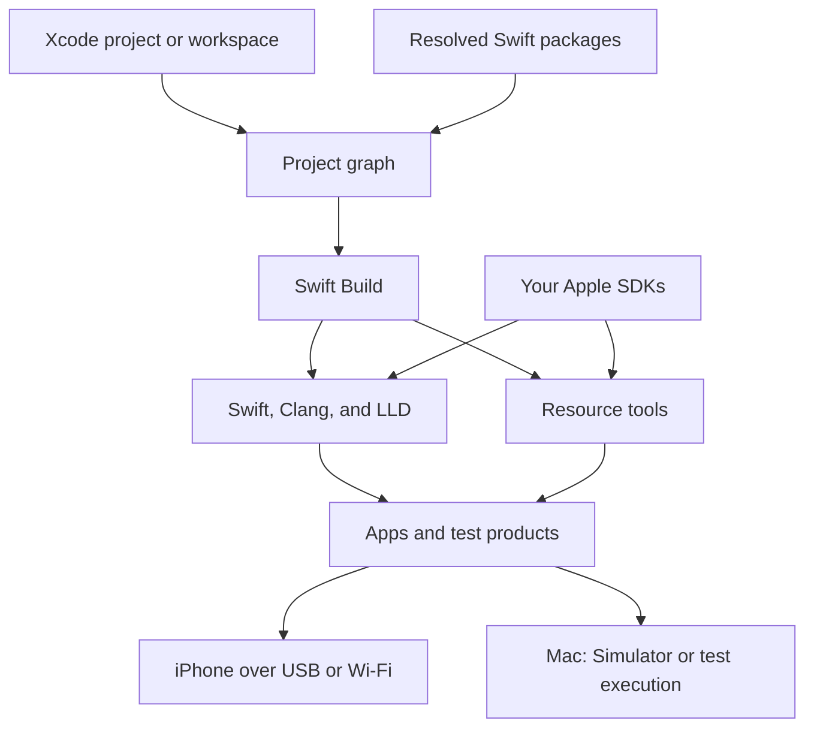

# How Linux builds work

SweetPad turns an Xcode project into input for Swift Build, Apple's open-source build system.
Swift Build schedules Linux compilers and portable resource tools against SDK data from your own Xcode.

## The build pipeline



### Read the project

SweetPad reads the workspace, projects, scheme, configurations, and target dependencies.
It describes them in the Project Interchange Format that Swift Build consumes.
Swift Package Manager supplies the package graph, including resolved remote packages and binary XCFrameworks.

Schemes from remote packages become available after dependency resolution.
`sweetpad dependency resolve`, `update`, and `add` use Swift Package Manager on Linux instead of `xcodebuild`.
They write the pins to the workspace's `Package.resolved`, which Xcode reads unchanged.
Listing schemes reads existing checkouts; it does not fetch packages.

### Compile for iOS

The compiler runs on Linux and emits code for the selected Apple destination.
For an iPhone, that destination uses the iOS device SDK and ARM64 code.
An x86_64 Linux host can build that ARM64 product. Host executables, including compiler plugins, use the Linux host architecture.
LLD links the objects into Mach-O executables and libraries.

The compiler toolchain and Apple SDK have different jobs.
The toolchain supplies executable Linux programs. The SDK supplies headers, modules, frameworks, runtime libraries, and platform metadata.

### Compile resources

SweetPad implements the resource tools that Swift Build expects.
These tools compile supported asset catalogs, storyboards, XIBs, String Catalogs, Core Data models, and App Intents data.

Many tool names resolve to the same SweetPad executable.
The executable selects the requested operation from its invocation name.

Supported Apple macros use a Linux plugin.
SweetPad also builds reachable package macros for the host when their source supports Linux.

## Build products and incremental work

Products use the DerivedData layout that the other CLI commands expect.
An explicit build directory keeps CI outputs and local experiments easy to find:

```bash
sweetpad build --project MyApp.xcodeproj --scheme MyApp \
  --destination 'generic/platform=iOS' --json --non-interactive \
  -- -derivedDataPath "$HOME/builds/MyApp"
```

Swift Build tracks inputs and reuses unchanged work.
Generated project inputs keep their timestamps when their contents do not change.
After you upgrade SweetPad or import an SDK from another Xcode, the next build compiles asset catalogs, interface files, and other resources again.
Two builds that share a DerivedData directory run one after the other, and the second one says it is waiting.
A fresh DerivedData directory provides a control when you compare a changed resource processor or toolchain.

### Run scripts

Run-script phases execute on Linux.
Apple's `sandbox-exec` profiles do not apply. Scripts use the Linux build environment.
A script's `PATH` holds the Swift toolchain and SweetPad's versions of these macOS tools:

- `xcrun`, which runs a tool by name, finds one with `--find`, and reports an SDK's path and versions with the `--show-sdk-*` options
- `ditto`, which copies files and folders, but leaves making and opening archives to `zip` and `unzip`
- `cc`, which sends a compile for an Apple target to Clang and any other compile to the host's `cc`
- `codesign`, `lipo`, `strip`, and `dsymutil`
- `actool`, `ibtool`, `momc`, `mapc`, and `xcstringstool`

Other macOS commands, such as `/usr/libexec/PlistBuddy`, `plutil`, `agvtool`, and `sw_vers`, aren't available.
A script that calls one needs a Linux equivalent, or it has to run on a Mac.

A process that a script starts in the background, such as a local server, keeps running after the script, and the build doesn't wait for it to exit.
When you stop a build with Ctrl-C, SweetPad stops the processes its scripts left running.

The build runs shell pre-actions and post-actions in the scheme's Build action.
Build pre-actions run before project translation, so they can generate source files.
Post-actions run only after a successful build. Archive actions run around archive assembly, after the build stage.
A script gets the build settings of the target it selects, which can be a target in a Swift package.
Send Email actions are skipped with a note, as xcodebuild skips them.
Test action scripts don't run. The Linux build stops at build-for-testing, and xcodebuild doesn't run them for that either.

## Settings and editor support

`sweetpad settings show` resolves build settings against the Darwin SDK, so `SDKROOT`, `DEVELOPER_DIR`, and the toolchain paths name files on the Linux machine.
`sweetpad bsp init` sets up sourcekit-lsp the same way it does on a Mac.
The editor's compiler arguments add the SDK's resource directories and the Apple macro plugin, which the Linux Swift compiler needs to read Apple's SDKs.
When sourcekit-lsp asks for a target's dependencies, SweetPad builds them with Swift Build into the DerivedData folder the arguments point at.

## Signing and the phone

Linux signing takes identities from P12 files and matches them with your provisioning profiles.
A build signs with the identity its build settings select, and an export signs again with the one its method needs.
The signer seals the app and its embedded bundles before installation.

The device adapter uses `pymobiledevice3==11.50.0` for USB and Wi-Fi.
When neither `SWEETPAD_DEVICE_PYTHON` nor `SWEETPAD_DEVICE_NETWORK_CONFIG` is set, the device commands run the `pymobiledevice3` command on PATH, and they exit with code 5 (`tool_missing`) unless it is that release.
It authenticates the selected device before installation or launch.
The modern adapter establishes its developer-service tunnel in userspace.

These are separate operations: a successful build creates products, and a successful installation transfers a signed product to the phone.
The [Ubuntu guide](ubuntu-usb.md) walks through both.

## Tests and other Apple platforms

Linux can compile iOS test products and generate an XCTest run manifest.
Xcode on a Mac supplies the test runtime, including the iPhone test runner.
[Prebuilt test execution](signing-and-testing.md#run-linux-built-tests) keeps the Linux compilation result intact.

The same engine also builds macOS apps and supported tvOS, watchOS, and visionOS simulator targets.
Their runtime coverage differs from iPhone coverage.
See [support and configuration](reference.md) and the separate [macOS CI guide](macos-ci.md).
