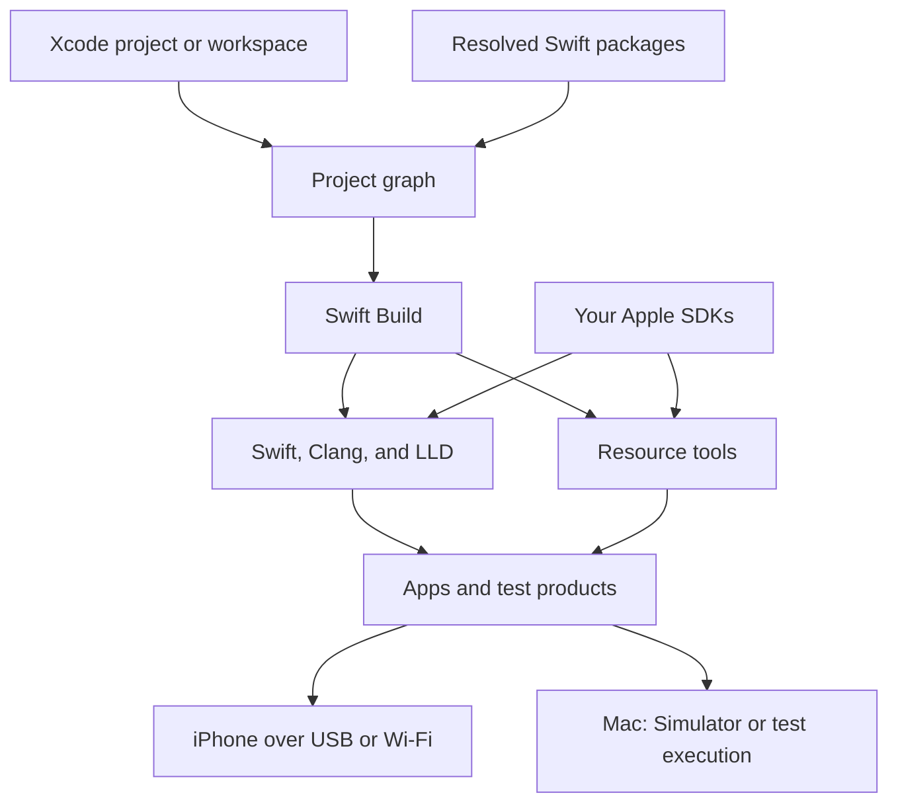

# How Linux builds work

SweetPad turns an Xcode project into input for Swift Build, Apple's open-source build system.
Swift Build schedules Linux compilers and portable resource tools against SDK data from your own Xcode.

## The build pipeline



### Read the project

SweetPad reads the workspace, projects, scheme, configurations, and target dependencies.
It describes them in the Project Interchange Format that Swift Build consumes.
Swift Package Manager supplies the package graph, including resolved remote packages and binary XCFrameworks.

Schemes from remote packages become available after dependency resolution.
Listing schemes reads existing checkouts; it does not fetch packages.

### Compile for iOS

The compiler runs on Linux and emits code for the selected Apple destination.
For an iPhone, that destination uses the iOS device SDK and ARM64 code.
LLD links the objects into Mach-O executables and libraries.

The compiler toolchain and Apple SDK have different jobs.
The toolchain supplies executable Linux programs. The SDK supplies headers, modules, frameworks, runtime libraries, and platform metadata.

### Compile resources

SweetPad implements the resource tools that Swift Build expects.
These tools compile supported asset catalogs, storyboards, XIBs, String Catalogs, Core Data models, and App Intents data.

Many tool names resolve to the same SweetPad executable.
The executable selects the requested operation from its invocation name.

Supported Apple macros use a Linux plugin.
SweetPad also builds reachable package macros for the host when their source supports Linux.

## Build products and incremental work

Products use the DerivedData layout that the other CLI commands expect.
An explicit build directory keeps CI outputs and local experiments easy to find:

```bash
sweetpad build --project MyApp.xcodeproj --scheme MyApp \
  --destination 'generic/platform=iOS' --json --non-interactive \
  -- -derivedDataPath "$HOME/builds/MyApp"
```

Swift Build tracks inputs and reuses unchanged work.
Generated project inputs keep their timestamps when their contents do not change.
A fresh DerivedData directory provides a control when you compare a changed resource processor or toolchain.

Run-script phases execute on Linux.
Apple's `sandbox-exec` profiles do not apply. Scripts use the Linux build environment.
The build supplies compatible tools for common Xcode script operations, but a script that depends on macOS still needs adaptation.

Current source builds also run shell pre-actions and post-actions in the scheme's Build action.
This support is newer than the 0.1.18 release.
Build pre-actions run before project translation, so they can generate source files.
Post-actions run only after a successful build. Archive actions run around archive assembly, after the build stage.
A script can use build settings from its selected project target.
Scripts that select a package target, non-shell execution actions, and Test action runtime hooks remain unsupported.

## Signing and the phone

Linux signing uses an Apple Development identity from a P12 file and your provisioning profiles.
The signer seals the app and its embedded bundles before installation.

The device adapter uses `pymobiledevice3==11.50.0` for USB and Wi-Fi.
It authenticates the selected device before installation or launch.
The modern adapter establishes its developer-service tunnel in userspace.

These are separate operations: a successful build creates products, and a successful installation transfers a signed product to the phone.
The [Ubuntu guide](ubuntu-usb.md) walks through both.

## Tests and other Apple platforms

Linux can compile iOS test products and generate an XCTest run manifest.
Xcode on a Mac supplies the test runtime, including the iPhone test runner.
[Prebuilt test execution](signing-and-testing.md#run-linux-built-tests) keeps the Linux compilation result intact.

The same engine also builds macOS apps and supported tvOS, watchOS, and visionOS simulator targets.
Their runtime coverage differs from iPhone coverage.
See [support and configuration](reference.md) and the separate [macOS CI guide](macos-ci.md).
