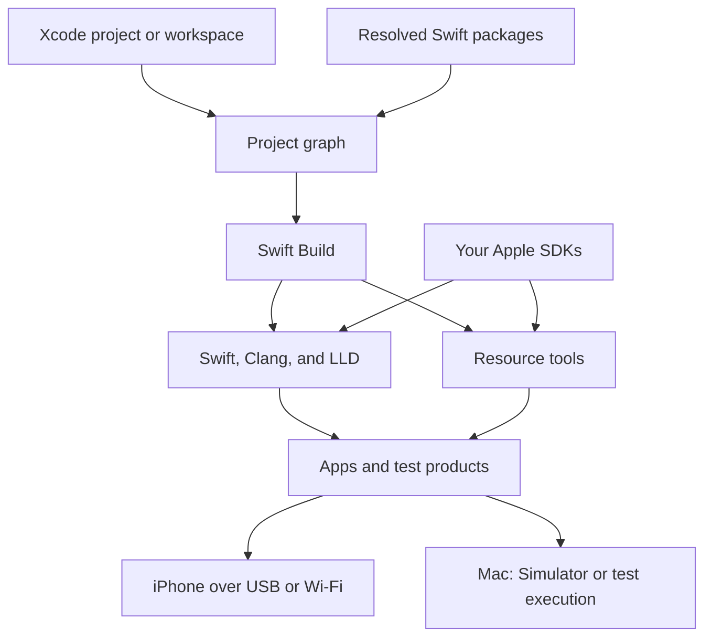

# How Linux builds work

On Linux, SweetPad builds with Swift Build, Apple's open-source build system, in place of Xcode.
Linux compilers and SweetPad's own resource tools do the work, against the SDKs from your Xcode.

## Project and packages

SweetPad reads the workspace, projects, scheme, configurations, and target dependencies, and hands Swift Build the same description of them that Xcode would.
Swift Package Manager resolves packages: `sweetpad dependency resolve`, `update`, and `add` write the workspace's `Package.resolved`, which Xcode reads unchanged.

## Compilers and resources

The Linux Swift and Clang compilers emit code for the Apple destination, and LLD links it into Mach-O apps and frameworks.
An x86_64 host builds the same ARM64 iPhone app as an ARM64 host does.

Asset catalogs, storyboards, XIBs, String Catalogs, Core Data models, and App Intents metadata go through SweetPad's versions of Xcode's tools.
Apple's macros run in a Linux plugin, and package macros build for the Linux host when their source supports it.

## Incremental builds

Products land in the usual DerivedData layout, so the other commands find them.
Swift Build reuses unchanged work. After you upgrade SweetPad or import an SDK from another Xcode, it compiles resources again.
Two builds that share a DerivedData folder run one after the other.

## Editor support

`sweetpad bsp init` sets up sourcekit-lsp as it does on a Mac, with compiler arguments that point at the Darwin SDK.
`sweetpad settings show` resolves build settings against that SDK too.

## Signing and devices

The signer reads identities from P12 files and matches them with your provisioning profiles.
A build signs with the identity its build settings select, and an export signs again with the one its method needs.

Device commands talk to the iPhone through `pymobiledevice3==11.50.0`, over USB or Wi-Fi.
Installing is separate from building: `sweetpad device install` sends an already-signed app to the phone.

## Tests

Linux compiles test products and writes the XCTest manifest that runs them.
A Mac with Xcode runs them [without compiling again](signing-and-testing.md#run-the-tests-on-a-mac).
